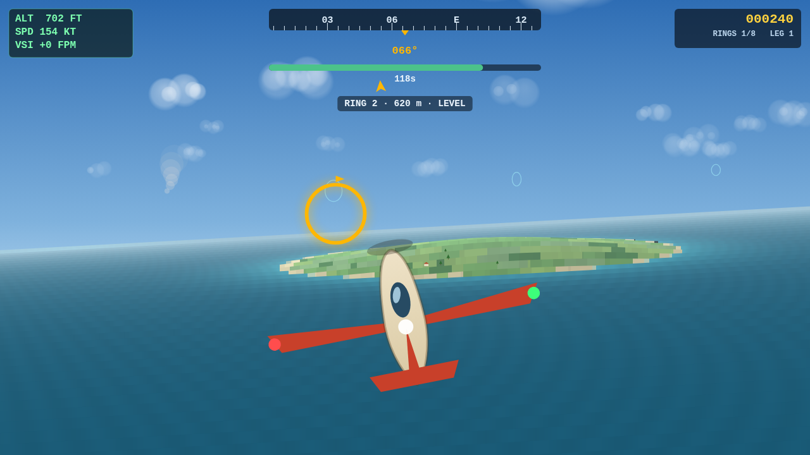

# SKYPOST — Archipelago Air Mail

[](https://make.fun/c/best-flight-game-20261126-0057)
[](https://make.fun/c/best-flight-game-20261126-0057)
[](https://make.fun/c/best-flight-game-20261126-0057)

A complete flight game in plain static files — no build step, no assets, no
network. You fly the morning mail run in a little prop plane: take off from
Skypost Field, thread a course of gold rings strung around a volcano
archipelago, and put the mail down at Farshore Strip before the clock and
the fuel run out.



## Play it

Serve the `game/` folder with any static file server and open `index.html`
in a desktop browser:

```
npx serve game          # or: python3 -m http.server -d game
```

## Controls

| Input | Effect |
| --- | --- |
| Arrow keys or mouse | Pitch and bank (the stick) |
| W / S | Throttle up / down |
| Shift or Space | Boost (drinks fuel) |
| C | Cockpit / chase camera |
| P | Pause |
| M | Sound on / off |
| R | Restart the leg |
| Enter | Start, next leg |

## The run

- **Take off** from Skypost Field: full throttle, pull back past 80 kt.
- **Thread every gold ring** — the compass tape and the guidance chevron
  point at the next one. A dead-center pass pays up to 300 points and every
  ring adds 8 seconds to the clock.
- **Land at Farshore Strip** to deliver: slow, aligned, and gentle for the
  full 500-point bonus. Ditch in the sea, hit the hills, or run the clock
  out and the leg is flown again.
- Each delivered leg strings a longer course, and from the second leg the
  archipelago wind starts pushing back.

## What's inside

- `game/src/world.js` bakes a seeded heightfield archipelago — two runway
  islands, a cratered volcano, rice-field patchwork, trees and houses.
- `game/src/terrain-view.js` renders it with a voxel-space ray march, the
  technique behind the early-nineties flight sims, plus the shared camera
  projection everything else draws through.
- `game/src/cockpit.js` draws the lit instrument panel: artificial horizon,
  airspeed, altimeter, VSI, fuel, warning lamps, a compass tape, and the
  always-on digital HUD (altitude, speed, heading).
- `game/src/flight.js` is the simulation: ground roll, stalls, wind, ring
  detection, landing quality, scoring.
- `game/src/audio.js` synthesises every sound with WebAudio — engine,
  ring chimes, warnings, jingles. There are no audio files.
- `main.ts` hands the entry in: it copies `game/` and `screenshots/` to the
  output directory and writes `dossier.json` with the kit's `buildDossier`.

The four screenshots are real renders of the game itself, taken in headless
Chrome from the deterministic states listed in `shots.json`
(`game/index.html?shot=chase`, `?shot=cockpit`, `?shot=takeoff`,
`?shot=approach`).

## License

MIT — see `LICENSE`.
